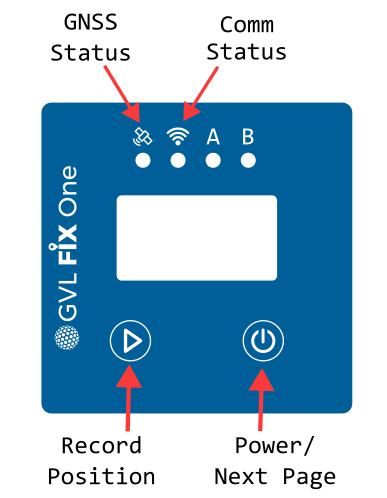

# Getting Started

## Legends

## Usage

* If not already done, [configure your device](./config.md).
* **Press and hold** power button for 2 seconds
	* Device turns on and boots into main screen
* Ensure open sky above antenna.
* Observe GNSS Status LED

| Color  | State      | Notes                                      |
|--------|------------|--------------------------------------------|
| Red    | No fix     | No position yet                            |
| Yellow | Single fix | Standalone GNSS, ~3–10 m                     |
| Blue   | DGNSS      | Differential, ~0.5–3 m                     |
| Purple | RTK Float  | Converging, ~0.1–1 m                       |
| Green  | RTK Fixed  | Highest precision, ~1–2 cm                 |

* Real-time telemetry is streamed to GVL Dashboard.

## Additional Features

* Press the `Power` button to cycle through information display
* Press the `Play` button to record a **manual survey point**
	* Current coordinates are saved to local storage
	* A special telemetry message is transmitted
* **Press and hold** `Power` button to switch off

## Configuration

See the [Configuration Page](./config.md) on how to set up your device.

## Firmware Update

See the [Firmware Update](./fw_update.md)
